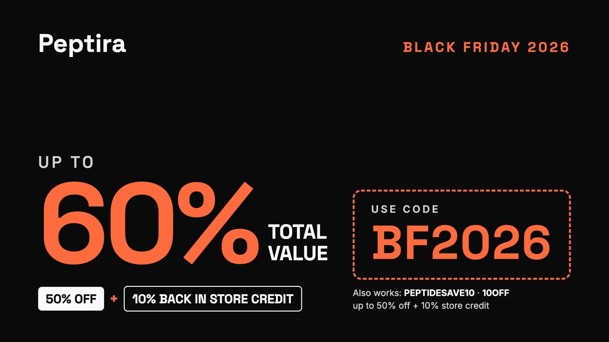

# Peptira Coupon Code BF2026: Up to 60% Off (50% Off + 10% Back) — Beat the Sale-Day Mind Traps

Peptira Coupon Code BF2026: up to 60% off (50% off + 10% back in credit). Spot urgency, anchoring and decoy traps; buy only what your lab needs.

**Offer facts, in four lines.** Enter `BF2026` at checkout through the Black Friday weekend (or `CM2026` on Monday; `PEPTIDESAVE10` and `10OFF` are worth exactly the same, and only one code fits on an order). Peptira's banner reads "Up to 50% off sitewide + 10% cash back thru Cyber Monday." The checkout discount tops out at 50%; the extra 10% arrives afterward as store credit, so the best case is worth about 55% in real terms, which is how "up to 60%" should be read. Everything closes at 11:59 PM Mountain Time on Monday, November 30, 2026.

*Research use only. Peptira sells its products strictly for in vitro laboratory research by buyers aged 21 or older; nothing here concerns human or animal use. Offer terms belong to Peptira and can change; your order summary on peptira.com is the authority on price.*

---

## Why a Good Discount Can Still Produce a Bad Order

A discount changes one number: the price. It does not change what your experiments need, how long a vial stays usable on your shelf, or how much freezer space you have. Yet most people who have shopped a big sale know the feeling of closing the browser with a cart that looks different from the list they started with. Something about the event itself pulled the order away from the plan.

That pull is not a character flaw. It comes from a set of mental shortcuts that every human brain uses, which psychologists have studied for half a century. In ordinary life the shortcuts save time. During a sale they get exploited, sometimes deliberately by retail design and sometimes just by circumstance: a ticking deadline, a big red percentage, a progress bar toward free shipping, a feed full of other people talking about their hauls.

For a research lab the stakes are concrete. Peptira's policy is that all sales are final and orders cannot be canceled or modified once placed. A household that overbuys sweaters can return them. A lab that overbuys research materials owns them, and if they degrade before anyone uses them, the "savings" turn into waste. A lab that underbuys because someone panicked and checked out half a list pays full price in February.

This guide walks through the specific traps that show up during a sitewide sale like Peptira's 2026 Black Friday event, explains in plain language why each one works, and gives a practical counter-move for each. It ends with a toolkit you can use in the ten minutes before you press the order button, and a look at how the store's own rules make slow thinking more valuable, not less.

Nothing in this guide argues against buying. The **Peptira Coupon Code BF2026** is a real discount on real list prices, and a lab with a clear need should use it. The goal is narrower: make sure the cart you submit is the cart you would have designed with a calm afternoon and a full cup of coffee.

### Two speeds of thinking

A useful frame comes from the psychologist Daniel Kahneman, who popularized the idea of two modes of thought. One is fast, automatic and effortless; it recognizes faces, reads a big "50%" instantly and feels urgency without being asked. The other is slow, deliberate and tiring; it does arithmetic, checks assumptions and compares options against a goal.

Sales are built for the fast mode. Large numbers, bright colors, short time limits and simple calls to action all reach the quick system before the slow one has a chance to get involved. None of that is sinister; it is simply how promotions get noticed. But it means that if you want the slow system in charge of a purchase that cannot be undone, you have to invite it in on purpose. Most of the counter-moves below are small rituals for doing exactly that.

### Who this is for

The examples assume someone ordering research materials for a lab: a lab manager, a principal investigator, a postdoc trusted with the account, or an independent researcher buying for their own bench. The traps are universal, though, and the same habits help anyone facing a deadline-driven sale.

## The Offer, Stated Without Spin

Before looking at traps, it helps to have a neutral description of what is actually on the table, because several of the traps work by distorting exactly these facts.

**The discount.** Peptira is running a sitewide sale advertised as up to 50% off. "Up to" matters: the percentage can vary by product, and the order summary shows the actual reduction on each line once you are signed in. Peptira displays prices only to signed-in customers, so the real numbers are visible only after logging in.

**The code.** `BF2026` is the Black Friday code. `CM2026` is the Cyber Monday code. Peptira's event terms give `PEPTIDESAVE10` and `10OFF` the same value. One code per order; codes do not stack. Typing a second code does not double anything.

**The credit.** After an order is paid, 10% comes back as store credit. This applies to paid orders placed through January 1, 2027 at 11:59 PM Mountain Time, including Auto-Ship orders, and Peptira says the credit does not expire. It is credit for future Peptira purchases, not cash in your bank account.

**The combined value.** On an item that takes the full 50% reduction, a \$100 list item costs \$50 at checkout, and \$5 of credit follows. If you eventually spend that credit, you received \$55 of value off a \$100 list price: about 55%. The "up to 60%" phrase adds the two percentages, which overstates the arithmetic slightly because the 10% is applied to a price that has already been cut in half.

**Shipping.** Standard domestic shipping is free on orders of \$250 or more. Shipping Protection is added by default at checkout and can be removed. Orders placed before 12:00 PM Mountain Time usually leave the same day.

**The rules that make mistakes permanent.** All sales are final. Orders cannot be canceled or changed after they are placed. Problems with a delivery must be reported within seven days, with an unboxing video.

**The deadline.** The sale ends at 11:59 PM Mountain Time on Monday, November 30, 2026.

Keep this list nearby. Several traps below depend on a slightly blurry version of it: "60% off everything," "the credit is basically cash," "I can always fix the order later." Each blur nudges the cart in the wrong direction.

## Trap 1: The Ticking Clock

### What it looks like

A sale with an end time creates a countdown in your head even if the site never shows one. "Ends Monday at midnight" becomes "I have to decide now." On Thanksgiving Thursday, with family in the next room and four days still on the clock, it is surprisingly easy to feel as though the window is closing.

### Why it works

Deadlines narrow attention. Under time pressure, people consider fewer options, rely more on whatever information is most visible, and are more willing to accept a choice that is merely good enough. Research on decision-making under time pressure has found this pattern repeatedly: as perceived time shrinks, people shift toward simpler rules and pay more attention to the most salient feature of an option. In a sale, the most salient feature is the discount, not the fit with your research plan.

The deadline also triggers a mild version of loss aversion, which is the well-documented tendency for losses to feel larger than equivalent gains. Missing a 50% discount feels like losing money, even though you have not spent anything. That feeling pushes toward action.

### The counter-move

Convert the deadline into a schedule. Instead of "ends Monday," write down the specific hour when you will place the order and work backward to the steps that must be done before it. For example: inventory count Friday morning, list confirmed Friday afternoon, approval by Saturday, order Sunday before noon Mountain Time. A schedule makes the remaining time visible as a resource instead of a threat.

Remember also that Peptira's 12:00 PM Mountain Time same-day dispatch cutoff is a better practical deadline than 11:59 PM Monday for most labs. An order placed late Monday night is still on sale, but it will not leave until Tuesday. If shipping timing matters, the real target is earlier, and knowing that ahead of time removes the sense of last-second panic.

A final point: the clock applies to the discount, not to your need. If the list is not ready by Monday night, the cost of waiting is the difference between sale and regular price on what you buy later. That is a real cost, but it is a known, bounded one. The cost of an unplanned, final, non-returnable order can be larger.

## Trap 2: The Anchor Price

### What it looks like

The product page shows a list price, the discounted price, and perhaps a crossed-out figure. Your eye lands on the larger number first. Everything after that is judged relative to it: "\$300 down to \$150, what a deal."

### Why it works

Anchoring is one of the most robust findings in decision research. In a classic 1974 paper, Amos Tversky and Daniel Kahneman described how people's numerical estimates are pulled toward a starting value, even an arbitrary one, and how they adjust away from that anchor insufficiently. In shopping, the list price is the anchor. The discounted price is evaluated as a gain relative to the anchor rather than as an absolute amount leaving your budget.

Anchors are not dishonest by nature. A list price is information. But the anchor shapes what feels reasonable. A \$150 item that would have seemed expensive on its own can feel cheap next to a \$300 reference.

### The counter-move

Use your own anchor. Before the sale, write down what you need and what each item is worth to your research: either the price you have paid before, or the budget line it comes from. Then evaluate the sale price against that personal reference, not against the list price the page shows.

A useful test is to ask, "Would I place this exact order at the price shown, if no list price were displayed?" If the answer is yes, the discount is a bonus. If the answer is "only because it used to be \$300," the anchor is doing the deciding.

For labs that track spending per experiment or per milligram, the most reliable personal anchor is cost per unit of research output. A sale price that brings cost per assay down to a level you could already justify is a good buy. A sale price on something you do not need has an effective cost per useful result of infinity, however large the crossed-out number.

## Trap 3: Percentages That Grow in the Telling

### What it looks like

"Up to 50% off plus 10% back" turns into "60% off" in conversation. "Up to 50% sitewide" turns into "half price on everything." By the time the message reaches the person holding the budget, the deal sounds bigger than it is.

### Why it works

Percentages are slippery. People are bad at combining them, and they tend to add percentages that should be multiplied. A 50% discount followed by a 10% credit on the discounted amount is not 60%; it is 55% at most, and only if the credit is later spent. "Up to" is also easy to drop because the maximum is the memorable part.

There is also a framing effect at work. The same price can be described as "\$50 off," "50% off," or "half price," and each frame feels slightly different. Large percentages feel more impressive than equivalent dollar amounts on cheap items, while dollar amounts feel more impressive on expensive items. Marketers choose frames accordingly, and our brains respond to the frame rather than the arithmetic.

### The counter-move

Do the math in dollars, at the line level, using the signed-in prices. A simple three-column note works: what the item would cost at regular price, what it costs at checkout with the code, and what credit you expect afterward. The total of the second column is what leaves your budget. The total of the third column is a future Peptira balance, not a reduction in today's spend.

When reporting the purchase to someone else, report the dollar figures and describe the offer accurately: "up to 50% off at checkout, plus 10% back as store credit." That phrasing avoids inflated expectations, which matter more than they seem. A PI who heard "60% off" and later sees an invoice reflecting 45% off on some lines may wonder what went wrong, when nothing did.

### A quick illustration

Suppose a lab's cart includes three items with these regular prices: \$180, \$240 and \$90, for a regular total of \$510. Suppose, for illustration, that the first two take the full 50% reduction and the third takes 30%. Checkout cost is \$90 + \$120 + \$63 = \$273. The credit is roughly 10% of what was paid, or about \$27. The checkout saving is \$237, which is 46% of the regular total. Counting the credit, the value is about \$264, or 52%. Both numbers are good. Neither is 60%. A lab that budgeted on the assumption of 60% would have expected to pay about \$204 and would be \$69 over plan before shipping or tax.

These figures are invented to show the arithmetic; your real prices appear only after signing in to peptira.com.

## Trap 4: The Free-Shipping Finish Line

### What it looks like

Your cart sits at \$212. Free standard shipping starts at \$250. Suddenly you are browsing for a \$38 add-on you had not planned, because paying for shipping now feels like a penalty.

### Why it works

Thresholds create goal gradients. Psychologists have observed that people speed up as they approach a goal, whether that is a punch-card reward at a coffee shop or a free-shipping bar. The closer you are, the stronger the pull. At the same time, the word "free" has outsized power. Behavioral economists have found that people often choose a free option over a better-value paid option, because zero feels categorically different from a small positive number.

Put those together and a modest shipping fee can trigger a purchase several times its size.

### The counter-move

Compare the add-on to the shipping fee directly. If shipping on your \$212 order costs a certain amount, the only rational reason to add \$38 of product is that you would have bought that product soon anyway and would have paid shipping on it separately. If so, adding it now is efficient. If not, you are spending \$38 to avoid a smaller fee.

A practical rule: keep a short "next-in-line" list during planning, made of items you expect to need within the next few months. If the cart is under \$250, pick from that list only. Never pick from the store's browsing pages just to reach a number. If nothing on the list fits, pay the shipping. It is usually the cheaper outcome.

There is a second, quieter version of this trap: splitting a large order into two smaller ones and losing free shipping on one of them, or merging two people's orders to reach the threshold and then struggling to allocate costs. Both are solvable, but they should be solved on paper before checkout, not improvised at the payment step.

## Trap 5: Loss Aversion Around the Credit

### What it looks like

You hear that 10% comes back as store credit and that the credit never expires. Some time later you notice a balance in your account. Now it feels wasteful not to spend it, so you look for something to buy. Alternatively, before ordering, you decide a larger order is better because it produces a larger credit.

### Why it works

Kahneman and Tversky's prospect theory, published in 1979, showed that people evaluate outcomes as gains and losses relative to a reference point, and that losses loom larger than gains of the same size. An unspent credit balance becomes a reference point. Leaving it unused registers as a small loss, which motivates spending.

The "bigger order, bigger credit" reasoning is a related distortion. The credit is a percentage of what you pay. Paying an extra \$200 to receive an extra \$20 of credit is a net outflow of \$180. It only makes sense if the extra \$200 was going to be spent anyway.

### The counter-move

Treat the credit as a discount on a future purchase you were already going to make, not as a reason to make one. Because the credit does not expire, there is no urgency to use it. The best time to spend it is the next time the lab places a planned order with Peptira, whether that is in January or in June.

For the pre-order version of the trap, apply the same question as for anchoring: would you add this item if the 10% back did not exist? If no, take it out.

Labs that share an account should also record who generated a credit and agree on how it will be applied. Otherwise the credit can quietly subsidize a different group's order, which is not a problem in itself but can cause friction when one budget paid for the original order.

## Trap 6: Too Many Options

### What it looks like

A sitewide sale means every product page is a candidate. You open fifteen tabs to compare, lose track of which concentration you wanted, and end up either ordering everything in the comparison or giving up and ordering nothing.

### Why it works

Psychologists Sheena Iyengar and Mark Lepper, in a well-known 2000 study, found that shoppers presented with a large assortment of jams were more likely to stop and look but less likely to buy than shoppers offered a small assortment. Later research has debated how general the effect is, but the core idea holds in many settings: when options multiply and the differences between them are hard to evaluate, decisions get harder and people either defer or fall back on crude rules.

In a lab purchasing context, the crude rules might be "buy the bigger size because it's cheaper per unit" or "buy both and figure it out later." Both can be reasonable in some cases. Both are poor defaults when the order is final and storage is limited.

### The counter-move

Decide the product, size and quantity before the sale page is open. Write each line as a complete specification: product name as listed, size, quantity, and the reason it is needed. If you cannot write a line completely, that item is not ready to order.

When a choice between sizes is genuine, settle it with two numbers: the expected usage over the time the material stays usable under your storage conditions, and the cost per unit at each size. A larger size is a good buy only if you will use it before it degrades. A smaller size wastes less if usage is uncertain. Checking the product page and certificate of analysis for storage guidance helps here, as does asking the people who will actually use the material.

Limit browsing. One focused pass through the store to confirm the items on your list is enough. Browsing beyond that mostly creates new desires.

### A side note on decoys

A close cousin of choice overload is the decoy effect, described by Joel Huber, John Payne and Christopher Puto in 1982. Adding a third option that is clearly worse than one of the other two makes that "better" option look more attractive, even though nothing about it changed. When three sizes of the same item sit side by side, the middle or largest one can look like the obvious pick simply because of what it is next to. The counter-move is the same as above: decide the size from expected usage and storage life before you see the size menu, and let the menu confirm the decision rather than make it.

## Trap 7: Everyone Else Is Buying

### What it looks like

Colleagues post about their orders. A group chat fills with screenshots of carts. A lab down the hall says they are stocking up for the year. It starts to feel as though not ordering heavily is a mistake.

### Why it works

Social proof is the tendency to treat other people's behavior as evidence of what is correct. Robert Cialdini described it as one of the core principles of persuasion: when uncertain, we look at what others are doing. It is often a reasonable shortcut. It becomes a trap when other people's circumstances differ from yours, which in research purchasing they almost always do. Another lab's projects, budget, storage capacity and timeline say little about what your lab should buy.

The National Retail Federation's surveys for the 2026 Thanksgiving weekend projected record numbers of shoppers. Big participation numbers make sales feel like events you have to join. They tell you about the market, not about your bench.

### The counter-move

Keep the decision anchored to your own inventory and plan. If a colleague's purchase prompts a genuine question, such as "should we also be stocking that?", treat it as an input to your list-making process, not as a reason to add the item at checkout. Ask what they plan to use it for, how long their supply typically lasts, and whether your use would be similar. If the answers do not match, the social signal does not apply.

For group or pooled orders, this matters even more. One enthusiastic person can pull everyone's quantities upward. A simple safeguard is to have each person submit their needs independently, in writing, before anyone sees the combined cart.

## Trap 8: Mental Accounting and "Found Money"

### What it looks like

Because the sale saves money, the savings start to feel like a separate pot that can be spent. "We saved \$400 on the core order, so we can afford to try that new product." Or the credit balance is mentally filed as "free," and items bought with it receive less scrutiny than items bought with budget dollars.

### Why it works

The economist Richard Thaler described mental accounting: people sort money into categories and treat it differently depending on its label, even though money is interchangeable. A windfall is spent more freely than earned income. A discount can be experienced as a windfall. Store credit is especially vulnerable because it has a distinct label, sits in a separate balance, and cannot be spent anywhere else.

The effect is not always bad. Thinking of savings as a pot can help a lab fund something useful it had postponed. The trap is when the pot gets spent on things that would not pass the ordinary test of need.

### The counter-move

Run every line through the same test, regardless of which pot pays for it. A useful phrasing: "If this item came out of our regular budget at today's price, would we approve it?" Items paid for with credit should pass that test just as items paid for with a card do.

If the lab does want to use sale savings for something new, decide that deliberately and in advance. Put the new item on the planned list with a stated research purpose and a quantity based on a realistic pilot. That turns a windfall impulse into a planned choice.

## Trap 9: Planning Fallacy at the Bench

### What it looks like

"We'll definitely run those experiments in January, so let's buy enough for the whole series now." Three months later half the material is still in the freezer because the project slipped.

### Why it works

The planning fallacy, another concept from Kahneman and Tversky's work, is the tendency to underestimate how long tasks will take and to assume that plans will go as intended. It is especially strong for one's own projects. Researchers know better than anyone that experiments get delayed by reagents, equipment, approvals, staffing and results that send the work in a new direction. In the moment of planning, though, the optimistic schedule feels realistic.

A sale amplifies this. The discount makes buying ahead feel efficient, and the optimistic schedule provides the justification.

### The counter-move

Use the outside view. Instead of asking how long this project will take, ask how long similar projects have actually taken in your lab. If the last three experimental series each started a month or two later than planned, assume the next one will too, and size the order to cover realistic usage rather than the ideal schedule.

Combine this with storage reality. For each item, estimate how long it remains usable under your storage conditions, using the product page, the certificate of analysis and your own experience. Then buy what you are confident will be used inside that window, with a modest margin. The sale will come around again; Peptira has run holiday events before, and many suppliers run promotions throughout the year.

## Trap 10: Escalating Commitment Inside the Cart

### What it looks like

You build a cart over an hour. You have checked prices, compared sizes and filled in details. At the end you notice the total is well above what you planned, but taking items out feels like throwing away the work, so you proceed.

### Why it works

The more effort we invest in a course of action, the harder it becomes to abandon it. This is related to the sunk cost effect, in which past investment influences decisions that should depend only on future costs and benefits. A carefully built cart represents invested effort. Removing items feels like admitting the effort was wasted.

There is also a consistency pressure. Once you have taken several steps toward a purchase, stopping feels inconsistent with your own earlier choices.

### The counter-move

Separate building the cart from approving it. Build the cart, then stop. Step away for a few minutes, or hand the summary to someone else. Then approve or trim it against the written list and budget as though you were reviewing someone else's work.

It also helps to set a hard ceiling before you start: a dollar figure that the order summary must not exceed. If the summary is higher, items come out until it fits. Having the ceiling decided beforehand means you are following a rule rather than making a fresh, effortful judgment at the moment you are most invested.

## Trap 11: Overconfidence About Fixing It Later

### What it looks like

"If I get the quantity wrong, I'll just email them." "If the address is off, they can change it." Assumptions that the order can be adjusted after the fact make the checkout feel lower-stakes than it is.

### Why it works

People tend to be overconfident about their ability to recover from mistakes, especially in familiar settings. Most online shopping allows easy cancellation or returns, so our default expectation is that errors are reversible.

### The counter-move

Read the store's actual rules and let them set your caution level. Peptira states that all sales are final and orders cannot be canceled or modified once placed. That means the order summary is the last chance to catch anything. Treat it like a document you are signing.

In practice this means checking each line, the shipping address, the code applied, whether Shipping Protection is on or off by your choice, and the total. Check them slowly, out loud if it helps. A one-minute pause here protects an order that cannot be undone.

## How the Traps Combine

Real decisions rarely involve one trap at a time. A typical sequence on Black Friday might look like this:

1. A colleague mentions a big order they placed (social proof).
2. You open the store and see large crossed-out prices (anchoring).
3. You think of the deal as 60% off (percentage inflation).
4. You browse widely, opening many product pages (choice overload).
5. You add items for projects that have not started (planning fallacy).
6. Your total lands just below \$250 and you add a filler (threshold pull).
7. You notice the total is high but feel committed to the cart (escalation).
8. You assume you can adjust later (overconfidence).
9. You check out at 11:40 PM on Monday because it is ending (time pressure).

Each step is small. Together they produce an order that might be twice the plan, contain items that sit unused, and leave after the same-day dispatch window. None of it would have happened with a written list, a ceiling, and a scheduled order time.

The encouraging part is that the counter-moves overlap. A written, fully specified list defeats choice overload, threshold padding, social proof and planning optimism at once. A personal price anchor defeats anchoring and percentage inflation. A scheduled order time defeats the clock. A separate approval step defeats escalation and overconfidence. You do not need eleven defenses. You need four habits.

## The Four Habits, in Short

**Habit one: write a complete list before the sale page is open.** Product, size, quantity, purpose. Nothing gets added at checkout that is not on it, except from a pre-written next-in-line list.

**Habit two: set your own price reference.** Use previous prices or budget lines, and evaluate in dollars, not percentages.

**Habit three: schedule the order.** Pick a day and an hour, ideally before the noon Mountain Time dispatch cutoff, and work backward.

**Habit four: separate building from approving.** Build the cart, step away, then approve against the list and ceiling. Treat the order summary as final, because it is.

## A Ten-Minute Debiasing Routine Before You Press "Place Order"

The habits above work best when they become a routine. Here is one that fits into ten minutes and can be used for any order during the sale, whether you are using `BF2026` on Friday or switching to `CM2026` on Monday.

### Minute 1–2: Restate the goal

Say or write, in one sentence, what this order is for. "Restock the three materials we use weekly, plus the two items for the January pilot." If you cannot state the goal in a sentence, the order is not ready.

### Minute 3–4: Compare the cart to the list

Line by line, check that every item in the cart is on the written list, at the specified size and quantity. Anything not on the list comes out, unless it is from the pre-approved next-in-line list.

### Minute 5: Check the money in dollars

Read the order summary total, after the code. Compare it to your ceiling. Note the expected credit separately and do not subtract it from today's spend.

### Minute 6: Apply the full-price test

For each line, ask whether you would approve it at today's price if no crossed-out list price were displayed. Remove anything that fails.

### Minute 7: Apply the shelf-life test

For each line, ask whether the quantity will be used within the time the material remains usable under your storage conditions. Reduce anything that fails.

### Minute 8: Check the mechanics

One code applied. The correct shipping address. Shipping Protection on or off by deliberate choice. Free shipping applied if the order is \$250 or more and domestic. Time of day noted relative to the noon Mountain Time dispatch cutoff.

### Minute 9: Get a second look

If possible, have someone else glance at the summary. A second person catches different errors. If no one is available, read the summary aloud to yourself; it slows the eye enough to catch typos and wrong sizes.

### Minute 10: Decide

Place the order, or close the browser and come back after a break. Either is a legitimate outcome. Walking away from an unready order is a success, not a failure.

## A Worked Example: Two Versions of the Same Lab

To see how much difference the habits make, consider a fictional lab with a regular monthly spend on research materials, preparing for Peptira's sale. The figures are invented for illustration.

### Version A: shopping on impulse

The lab manager opens the store on Thanksgiving evening after hearing that another group placed a large order. They browse for forty minutes, adding items that look useful. They pick larger sizes because the per-unit price is lower. They add items for a project expected to start in spring. The cart reaches \$236, and they add a \$40 item to reach free shipping. Realizing the total is above what they intended, they decide it is fine because of the credit. They check out late Monday night.

Outcome: a \$276 order before tax, roughly double the planned spend. About a third of the material is for a project that later slips to summer. Some of it reaches the end of its usable window under the lab's storage conditions before it is needed. The order ships Tuesday, a day later than it could have.

### Version B: shopping with the habits

The same lab manager counts inventory Friday morning and writes a list of five items with sizes, quantities and purposes. They set a ceiling based on the month's budget and the expected discount. They note two lower-priority items on a next-in-line list. On Saturday they sign in, check prices, and confirm the cart totals \$218. They add one item from the next-in-line list, bringing the order to \$252, which they would have bought in January anyway. They review the summary against the list, confirm `BF2026` is applied and Shipping Protection is on by choice, and place the order Sunday at 10:30 AM Mountain Time.

Outcome: a \$252 order that matches the plan, ships the same day, and produces credit the lab expects to use on its next planned order.

The difference between the versions is not intelligence or discipline in general. It is a few written decisions made before the store was open.

## The Store's Rules Make Slow Thinking Worth More

There is a broader point here. The value of careful thinking depends on how reversible a decision is. When a decision can easily be undone, fast thinking is usually fine; errors are cheap. When it cannot, the value of a pause goes up.

Peptira's rules put purchases firmly in the second category:

- **All sales are final.** There is no return window to fall back on.
- **No cancellations or modifications.** The order summary is the last chance to adjust.
- **Claims within seven days with an unboxing video.** If something is wrong on arrival, there is a short window and a documentation requirement. That rewards having a plan for receiving before the package arrives.
- **Prices visible only when signed in.** You need to sign in before you can evaluate the real numbers, which is a small natural speed bump.
- **Shipping Protection on by default.** Defaults are powerful; whatever is pre-selected tends to stay selected. Whether to keep it is a choice worth making deliberately rather than by inertia.

None of these rules is unusual for research supply vendors, and they protect both sides from disputes. But they mean that the usual consumer safety nets are not there. The decision you make at checkout is the decision you live with. That is exactly the situation in which a ten-minute routine pays for itself many times over.

## When the Biases Work for You

It would be unfair to cast every mental shortcut as an enemy. Some of the same tendencies that create traps can be turned into tools.

**Defaults can protect you.** If the lab makes a standing rule, such as "we always order before noon Mountain Time" or "every sale order needs a second reviewer," that rule becomes a default that carries good behavior forward without effort.

**Commitment can keep you on track.** Writing the list and sharing it with a colleague creates a small commitment that makes impulse additions feel inconsistent. Consistency pressure then works in your favor.

**Social proof can spread good habits.** If one person in a department starts sharing a short pre-order checklist, others tend to follow. Visible good practice is as contagious as visible spending.

**Loss aversion can motivate the boring steps.** Framing the review step as "avoiding a permanent mistake" rather than "double-checking" makes it feel worth the time.

The aim is not to eliminate instinct, which is impossible, but to arrange the situation so that instinct and the plan point the same way.

## Group Decisions Have Their Own Traps

When several people share a Peptira account or pool their needs into a single order, a few additional patterns appear.

**Groupthink.** In a group, the desire for agreement can suppress doubts. If the most senior person suggests stocking up heavily, others may not mention that storage is already tight. The fix is to collect needs and concerns independently, in writing, before the group meets.

**Diffusion of responsibility.** When everyone contributes to an order, it can feel as though no one in particular owns the final check. Name one person as the order owner, responsible for the final review and for pressing the button. Name a second as reviewer.

**Anchoring on the first number.** In a group discussion, the first budget figure mentioned tends to become the reference. If someone opens with "let's spend a thousand," the conversation will orbit that number. Let the needs list drive the total instead of starting with a figure.

**Status quo pressure in reverse.** Sometimes groups default to "let's just do what we did last year," even when needs have changed. A quick look at what was actually used from last year's sale order is more informative than repeating its quantities.

A short written process covers all of these: independent submissions, a named owner and reviewer, a total derived from the list, and a comparison with actual past usage.

## Questions Readers Ask About Sale-Day Psychology

### Isn't it rational to buy more when prices are lower?

Sometimes. If you have a reliable, ongoing need, adequate storage and enough usable time on the material, buying ahead at a lower price can be sound. The question is whether all three conditions hold. The traps described here make it easy to assume they do when they do not.

### Does knowing about biases actually help?

Knowing alone helps a little. Research on debiasing suggests that awareness is weaker than structure: checklists, pre-commitments, defaults and second reviewers change behavior more reliably than good intentions. That is why this guide emphasizes habits and routines rather than willpower.

### Should I avoid the sale to be safe?

Not if you have a real need. The sale is a genuine opportunity to lower the cost of planned research purchases. Using `BF2026` or `CM2026` on a planned order is simply good stewardship of a research budget. The aim is to buy well, not to avoid buying.

### Are the backup codes a trap?

No. `PEPTIDESAVE10` and `10OFF` carry the same value as the event codes under Peptira's terms. They exist as alternatives, not as additional discounts. Since only one code applies per order, trying several does not increase the savings. The only trap is believing they stack.

### Is the deadline real?

Peptira states the sale ends at 11:59 PM Mountain Time on Monday, November 30, 2026. Treat it as real, and plan to finish earlier than that.

### What if I already placed an impulsive order?

Because orders cannot be canceled or modified, the practical steps are to receive it carefully, store it properly, and fold it into your inventory and planning so the material gets used. Record what happened so the next sale goes differently. The 10% credit will also be in your account for the next planned order.

## A Reflection Exercise for After the Sale

A week or two after the sale, when the order has arrived and the rush is over, spend a few minutes answering these questions in writing. They are designed to improve the next sale, not to assign blame for this one.

1. What did we plan to buy, and what did we actually buy?
2. Which items, if any, were added at checkout, and why?
3. Did the order go out the same day, or did timing slip?
4. How close was the final total to our ceiling?
5. Is any of what we bought likely to go unused before its usable window ends?
6. Which of the traps in this guide showed up, if any?
7. What one change would make the next sale order easier?

Keep the answers with the order record. Over two or three sales, the pattern of answers becomes the most useful guide your lab has, because it is based on your actual behavior rather than general research.

## Summary

- **The offer is real and worth using for planned purchases.** Up to 50% off at checkout with `BF2026` (or `CM2026` on Monday, or `PEPTIDESAVE10` or `10OFF`; one code per order), plus 10% back as non-expiring store credit, until 11:59 PM Mountain Time on November 30, 2026. "Up to 60%" means about 55% in real value at the maximum.
- **Sales trigger predictable mental shortcuts:** deadline pressure, anchoring, percentage inflation, threshold pull, loss aversion, choice overload, social proof, mental accounting, planning optimism, escalating commitment and overconfidence.
- **Four habits defeat most of them:** a complete written list, your own price reference in dollars, a scheduled order time, and a separate approval step.
- **The store's rules raise the value of slow thinking.** All sales are final, orders cannot be canceled or modified, and claims need an unboxing video within seven days.
- **Use the ten-minute routine** before every order, and the reflection exercise after the sale.

## Sources

Checked on or before November 26, 2026.

- Peptira homepage: https://peptira.com/ (sale banner, sign-in to see prices, support hours)
- Peptira Shipping Policy: https://peptira.com/policies/shipping (dispatch timing, Shipping Protection, seven-day claims with unboxing video)
- Peptira Refunds and Returns: https://peptira.com/policies/refunds (all sales final, no cancellations or modifications)
- Peptira Terms and Conditions: https://peptira.com/policies/terms (21+, research use only)
- Peptira 2026 holiday event terms (codes BF2026, CM2026, PEPTIDESAVE10, 10OFF; one per order; sale end; 10% back on paid orders through January 1 including Auto-Ship; non-expiring credit; free domestic shipping at \$250)
- Tversky, A., and Kahneman, D. (1974). Judgment under Uncertainty: Heuristics and Biases. *Science*, 185(4157), 1124–1131. https://doi.org/10.1126/science.185.4157.1124
- Kahneman, D., and Tversky, A. (1979). Prospect Theory: An Analysis of Decision under Risk. *Econometrica*, 47(2), 263–291. https://doi.org/10.2307/1914185
- Iyengar, S. S., and Lepper, M. R. (2000). When Choice Is Demotivating. *Journal of Personality and Social Psychology*, 79(6), 995–1006. https://doi.org/10.1037/0022-3514.79.6.995
- Thaler, R. (1985). Mental Accounting and Consumer Choice. *Marketing Science*, 4(3), 199–214. https://doi.org/10.1287/mksc.4.3.199
- Huber, J., Payne, J. W., and Puto, C. (1982). Adding Asymmetrically Dominated Alternatives. *Journal of Consumer Research*, 9(1), 90–98. https://doi.org/10.1086/208899
- U.S. Federal Trade Commission (2022). Bringing Dark Patterns to Light (staff report): https://www.ftc.gov/reports/bringing-dark-patterns-light
- National Retail Federation, Thanksgiving weekend 2026 shopping survey (November 2026): https://nrf.com/

---

*Research use only. Peptira products are intended solely for in vitro laboratory research and are not for human or animal consumption, diagnosis, treatment, cure or prevention of any condition. Buyers must be 21 or older. Offer details reflect Peptira's 2026 holiday event terms and peptira.com as checked on November 26, 2026; Peptira may change them at any time. This article is general information about decision-making, not financial advice.*
